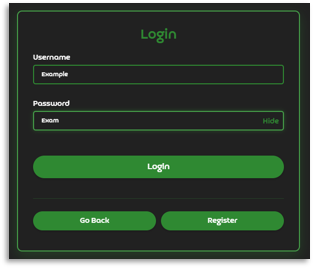
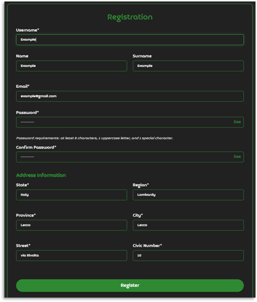
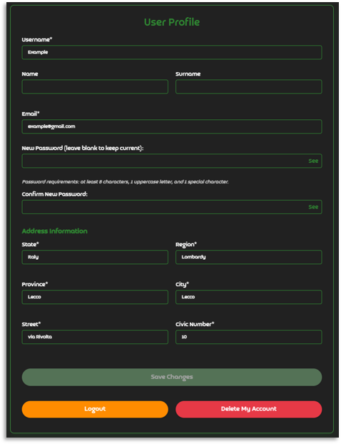
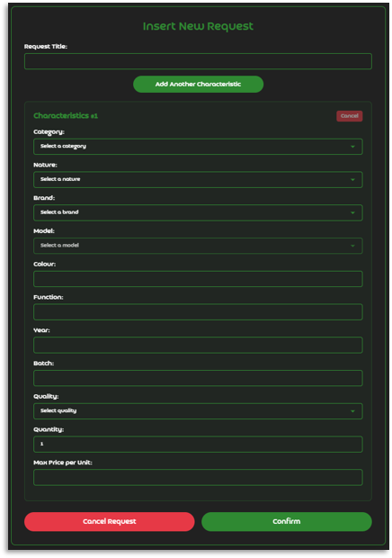
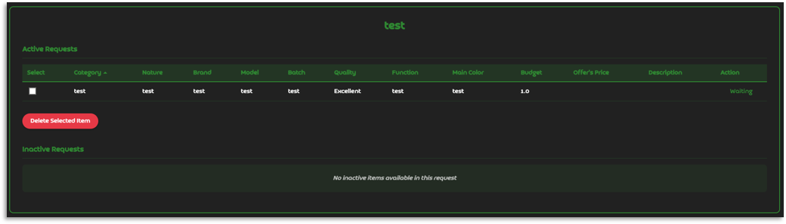
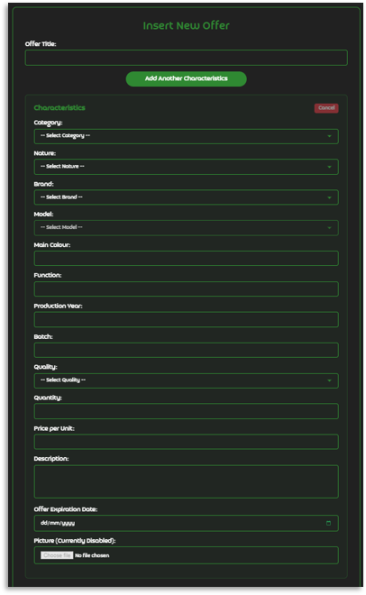
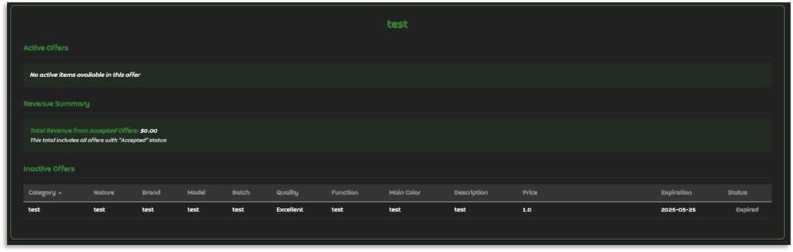

# E-Cycle

Marketplace platform for reselling unused goods through characteristic-based matching between requests and offers.

## Table of Contents

- [Features](#features)
- [Screenshots](#screenshots)
  - [Login](#login)
  - [Registration](#registration)
  - [Profile Edit](#profile-edit)
  - [Request Insertion](#request-insertion)
  - [Request Details](#request-details)
  - [Offer Insertion](#offer-insertion)
  - [Offer Details](#offer-details)
- [Project Structure](#project-structure)
- [Setup](#setup)
  - [Prerequisites](#prerequisites)
  - [Quick Start](#quick-start)
- [Run](#run)
- [Usage](#usage)
- [Configuration](#configuration)
- [Tech Stack](#tech-stack)
- [Support](#support)
- [Licence](#licence)
- [Author](#author)

## Features

- **Accounts:** Register with personal and address details, log in, edit the profile or delete the account from the profile page. Accounts are required because every request and offer belongs to a user; passwords are stored as SHA-256 hashes salted with the last password-update timestamp, and the login session identifies the user on every page.
- **Requests and offers:** Publish requests describing wanted goods and offers describing goods for sale. Each publication has a title and one or more item groups, because one request or offer can cover several distinct items. Start from the home page with **Create New Request** or **Create New Offer**.
- **Structured characteristics:** Describe each item group by category, nature, brand, model, main colour, function, quality (`Excellent`, `Good`, `Acceptable`, `Needs Revision`, `Broken`), production year, batch, quantity and price. Category, nature, brand and model are chosen from the existing catalogue or entered manually; values that do not exist yet are created when the request or offer is submitted, so the catalogue grows with use.
- **Matching:** Pair an offer with a request automatically when both share the same stored characteristics, belong to different users, and the request has no pending negotiation. The request's maximum price must also be less than or equal to the offer price. Matching runs after each publication, deletion, acceptance and rejection, so items are paired without a manual search. Pending matches appear as negotiations on the request details page.
- **Negotiations:** Review each matched offer on the request details page, where its price and description are shown next to **Accept** and **Reject**. The application closes a negotiation once it is older than 24 hours, and the check runs after each publication, deletion, acceptance or rejection; a rejection or timeout closes it without an agreement.
- **Offer lifecycle:** Offers carry an expiration date and individual items can be deleted. Expired, deleted and accepted items stop being available for matching, and the offer details page lists active and inactive items with the statuses `Waiting`, `Pending Negotiation`, `Accepted`, `Expired` and `Deleted`.
- **Revenue summary:** The offer details page shows the total revenue from accepted offers, so the seller can see the value of completed matches without adding up individual items.
- **Bulk quantities:** A quantity between 1 and 500 expands an item group into that many single requests or offers. A negotiation reserves one single item, and the remaining items stay available.

## Screenshots

### Login



### Registration



### Profile Edit



### Request Insertion



### Request Details



### Offer Insertion



### Offer Details



## Project Structure

```text
E-Cycle/
├── .mvn/wrapper/                      # Maven Wrapper configuration
├── docs/
│   ├── images/                        # UI screenshots
│   └── e-Cycle.pptx                   # Project presentation
├── src/
│   ├── main/
│   │   ├── java/ecycle/ecycle/
│   │   │   ├── controllers/           # HTTP routes (AppController)
│   │   │   ├── models/                # JPA entities
│   │   │   │   └── bodies/            # Request body classes
│   │   │   ├── repositories/          # Spring Data repositories
│   │   │   ├── services/              # Business logic and matching algorithm
│   │   │   └── EcycleApplication.java # Application entry point
│   │   └── resources/
│   │       ├── static/
│   │       │   ├── css/               # Stylesheets
│   │       │   ├── fonts/             # Custom font
│   │       │   ├── images/logos/      # Logos
│   │       │   └── js/                # Client-side scripts
│   │       ├── templates/             # Thymeleaf templates
│   │       └── application.properties # Configuration
│   └── test/java/ecycle/ecycle/
│       └── EcycleApplicationTests.java
├── ecycle-empty.sql                   # Database schema
├── mvnw                               # Maven Wrapper for Unix-like systems
├── mvnw.cmd                           # Maven Wrapper for Windows
├── pom.xml                            # Maven build configuration
├── LICENSE
└── README.md
```

The project follows a standard Spring Boot layout:

- **controllers/**: Handles HTTP requests and view routing.
- **models/**: JPA entities and form/request body classes.
- **repositories/**: Database access interfaces.
- **services/**: Core business logic and matching algorithm.

## Setup

### Prerequisites

- Java 24 or newer
  - [Oracle](https://www.java.com/it/download/manual.jsp) or [OpenJDK](https://openjdk.org/)
- MySQL 8.0 or newer
  - [MySQL Community Server](https://dev.mysql.com/downloads/mysql/)
- Maven 3.6 or newer (optional; the bundled Maven Wrapper downloads Maven 3.9.9)

### Quick Start

1. **Clone the repository:**

   ```bash
   git clone https://github.com/LorenBll/E-Cycle.git
   cd E-Cycle
   ```

2. **Create the database schema.** The script drops and recreates the `ecycle` database, so any existing data in it is lost:

   ```bash
   mysql -u root -p < ecycle-empty.sql
   ```

3. **Configure the database connection.** Edit `src/main/resources/application.properties` with the local credentials:

   ```properties
   spring.datasource.url=jdbc:mysql://localhost:3306/ecycle
   spring.datasource.username=root
   spring.datasource.password=
   ```

4. **Resolve dependencies.** The first Maven command downloads the project dependencies and Maven itself when the wrapper is used; no separate dependency installation step exists.

## Run

Start the application from the repository root:

```bash
./mvnw spring-boot:run
```

On Windows, use the command script:

```bat
mvnw.cmd spring-boot:run
```

A local Maven installation also works with `mvn spring-boot:run`. The application listens on port 8080, the Spring Boot default, because `server.port` is not set. Open `http://localhost:8080`.

To run a packaged build:

```bash
./mvnw package
java -jar target/ecycle-0.0.1-SNAPSHOT.jar
```

## Usage

1. Register a new account or log in with existing credentials.
2. Complete the profile with personal and address details.
3. Create a request describing the wanted goods, their characteristics, quantity and maximum price per unit.
4. Create an offer listing goods for sale, with their characteristics, quantity, price per unit, description and expiration date.
5. Matching runs on publication. Open a request from the home page to review the matched offers and their prices and descriptions.
6. Accept or reject each proposal before the 24-hour negotiation timeout, then follow the item statuses on the request and offer details pages.

## Configuration

The application reads the options below from `src/main/resources/application.properties`. It defines no environment variables, `.env` file or application-specific command-line options.

| Option | Default | Effect |
| --- | --- | --- |
| `spring.application.name` | `ecycle` | Sets the application name reported by Spring Boot. |
| `debug` | `true` | Enables Spring Boot debug logging for core components. |
| `spring.thymeleaf.check-template` | `false` | Skips the template existence check before rendering. |
| `spring.thymeleaf.enabled` | `true` | Enables Thymeleaf view rendering. |
| `spring.thymeleaf.prefix` | `classpath:/templates/` | Sets the directory that holds the templates. |
| `spring.thymeleaf.suffix` | `.html` | Sets the file extension appended to view names. |
| `spring.thymeleaf.mode` | `HTML5` | Sets the template mode used by the Thymeleaf parser. |
| `spring.thymeleaf.cache` | `false` | Disables the template cache, so template edits appear without a restart. |
| `server.error.include-message` | `always` | Includes the error message in error responses. |
| `server.error.include-binding-errors` | `always` | Includes validation binding errors in error responses. |
| `server.error.include-stacktrace` | `never` | Never includes stack traces in error responses. |
| `server.error.include-exception` | `true` | Includes the exception class name in error responses. |
| `spring.datasource.url` | `jdbc:mysql://localhost:3306/ecycle` | Sets the JDBC URL of the MySQL database. |
| `spring.datasource.username` | `root` | Sets the database user. |
| `spring.datasource.password` | empty | Sets the database password; enter the local MySQL password. |
| `spring.datasource.driver-class-name` | `com.mysql.cj.jdbc.Driver` | Sets the JDBC driver class. |
| `spring.jpa.hibernate.ddl-auto` | `update` | Lets Hibernate update the schema to match the entities at startup. |
| `spring.jpa.show-sql` | `true` | Prints executed SQL statements to the console. |
| `spring.jpa.properties.hibernate.dialect` | `org.hibernate.dialect.MySQL8Dialect` | Sets the SQL dialect used by Hibernate. |
| `server.servlet.session.tracking-modes` | `cookie` | Carries the session ID only in a cookie, not in URLs. |
| `spring.jpa.hibernate.naming.physical-strategy` | `org.hibernate.boot.model.naming.PhysicalNamingStrategyStandardImpl` | Uses the table and column names declared on the entities unchanged. |

## Tech Stack

- **Backend:** Java 24, Spring Boot 3.5.3, Spring Web (MVC and REST), Spring Data JPA with Hibernate
- **Frontend:** Thymeleaf, HTML5, CSS, JavaScript
- **Database:** MySQL 8.0+
- **Build Tool:** Maven
- **Other:** Lombok

## Support

Report bugs and request features through the GitHub issue tracker: <https://github.com/LorenBll/E-Cycle/issues>.

## Licence

Released into the public domain under the [Unlicense](LICENSE). See also <https://unlicense.org>.

## Author

[LorenBll](https://github.com/LorenBll)
